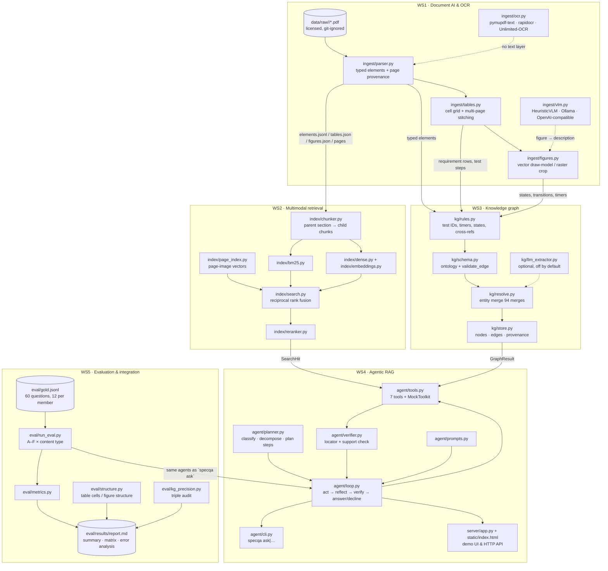
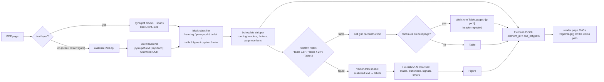
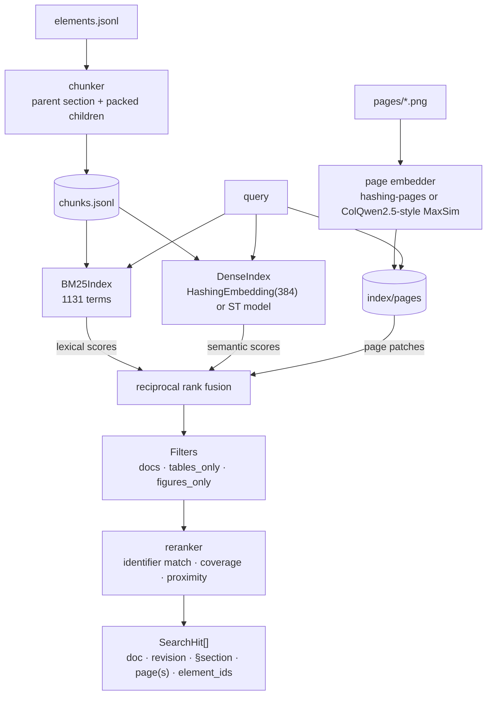
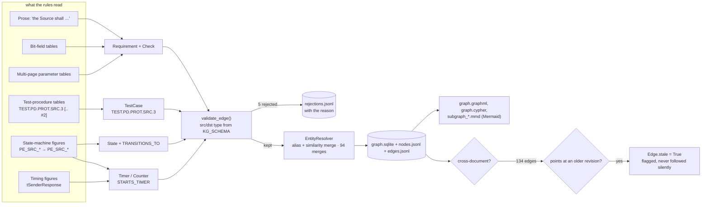
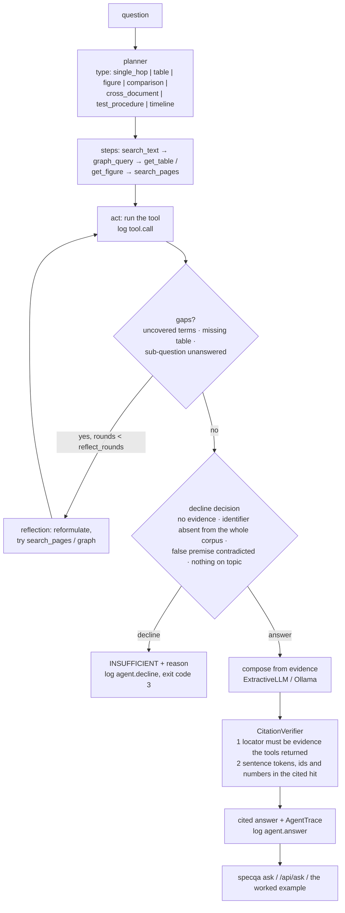
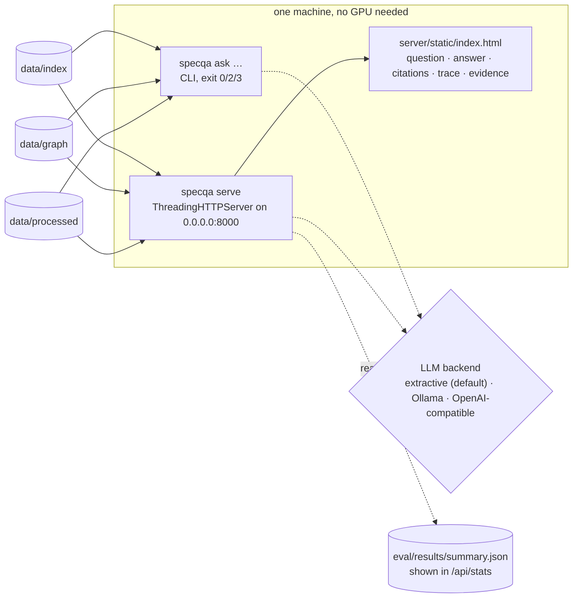

# DIAGRAMS.md — how the system is put together

Seven diagrams, one per layer, plus the worked example trace. They are Mermaid,
so they render on GitHub and in most editors, and they were kept in the same
naming as the code so a reader can jump from a box to a module.

---

## 1. System overview — five workstreams, one data ladder



Everything between the workstreams is one of the dataclasses in
`common/models.py`; nothing reaches across a boundary by importing an internal
function of another workstream (see `INTERFACES.md §1`).

---

## 2. WS1 — from PDF bytes to typed elements with page provenance



Namespacing note: numbering differs per book (PD writes `Table 6.8.`, Type-C
`Table 4-27`, Tech 2 restarts at `Table 1` per book), so every id is prefixed
with the document — `pd:table:tbl_3`, `tech2:figure:2`. Nothing downstream may
assume a number is unique across documents.

---

## 3. WS2 — hybrid retrieval and the page (vision) path



The page path exists because a waveform or a state diagram is not a sentence:
`search_pages` returns the page image (and its patch boxes) so the agent can
answer from layout rather than from a description of layout. Config C is that
path alone, which is the capstone-04 vision-first approach; the interesting
result is that it is *much* weaker than fusion on this corpus (`eval/results/`).

---

## 4. WS3 — requirements, timers, states and test cases in one graph



Every edge carries `doc_id`, `page`, `section_number`, `extraction_method` and
`confidence`; `evaluate_edge_provenance` scores that coverage and
`audit_triples` scores schema validity over `triple_sample.jsonl`. The
test-spec-versus-base-spec trap (the CTS revisions are older than the
specifications they test) is exactly what `stale` is for.

---

## 5. WS4 — the agent loop, and where an answer can be refused



Two properties matter more than accuracy here:

1. **A decline is a first-class outcome.** `--trace` shows the reason; the CLI
   exits `3`; the evaluation scores it as correct when the question is
   unanswerable.
2. **The verifier can only remove claims, never add them.** If verification
   empties the answer, the run becomes a decline rather than an uncited answer —
   the guard that caught the citation-marker bug described in `TEAM.md`.

---

## 6. WS5 — what is measured, against what

```mermaid
flowchart LR
  GQ[("eval/gold.jsonl<br/>60 q · 41 dev / 19 held-out<br/>categories S T F X C G V U")]
  for each of ["A naive dense", "B +hybrid+rerank", "C vision only", "D fused + tables/figures", "E +KG tool", "F +agent loop"]: CFG["config"]
  CFG --> RUN["run_eval.py --configs A,…,F<br/>same gold set, same corpus"]
  GQ --> RUN
  RUN --> M1["retrieval<br/>recall@5/@10 · MRR · nDCG@5"]
  RUN --> M2["answer<br/>correctness · faithfulness · citation accuracy"]
  RUN --> M3["honesty<br/>refusal accuracy · false answers · over-refusals"]
  RUN --> M4["structure<br/>table cell acc. · figure structure acc."]
  RUN --> M5["graph<br/>triple precision · edge provenance"]
  M1 --> AGG["aggregate by category, by content type,<br/>per config, dev vs held-out"]
  M2 --> AGG
  M3 --> AGG
  M4 --> AGG
  M5 --> AGG
  AGG --> REP[("eval/results/<br/>report.md · summary.json · matrix.json<br/>answers_*.jsonl · traces_*.jsonl · error_analysis.json")]
  AGG --> ABL["scripts/ablate.py → ablation.json<br/>7 single-component switch-offs"]
  REP --> ERR["error_analysis.py stages:<br/>retrieval miss → wrong evidence → unsupported claim →<br/>citation miss → over-refusal → false answer"]
```

`a gold question the corpus cannot answer` is part of the gold set on purpose
(category U): a system that never declines cannot score 1.000 on refusal
accuracy, and one that declines everything cannot answer the other 57.

---

## 7. Deployment — one process, two entry points



The server binds `0.0.0.0`, performs no Host/Origin check and sends no
framing headers, so it also works behind a preview proxy. It is stateless
apart from the lazily built index/graph/agent, and the whole thing is
one `python3 -m specintel.agent.cli serve` process.

---

## 8. The worked example, as a sequence

Question: *"What are the limits of tSenderResponse in Table 6.8?"* — the trace
below is the one captured from `/api/ask` and reproduced in
`docs/WORKED_EXAMPLE.md`.

```mermaid
sequenceDiagram
  autonumber
  participant U as user
  participant A as SpecAgent (agent/loop.py)
  participant P as Planner
  participant T as Toolkit (agent/tools.py)
  participant I as SearchIndex (WS2)
  participant G as GraphStore (WS3)
  participant V as CitationVerifier

  U->>A: ask("What are the limits of tSenderResponse in Table 6.8?")
  A->>P: plan(question)
  P-->>A: type=table · identifiers=[tSenderResponse] · steps=[search_text, graph_query, get_table]
  A->>T: search_text("tSenderResponse", k=8)
  T->>I: BM25 ⊕ dense → RRF → rerank
  I-->>T: hits: pd §6.6 p.4 Table 6.8 (table row), pd §6.6 p.3, …
  T-->>A: ToolResult(hits=8)
  A->>T: graph_query(kind=neighbors, name="tSenderResponse")
  T->>G: neighbors("Timer:tsenderresponse", depth=1)
  G-->>T: DEFINED_IN → Table 6.8, Section 6.6, Section 8; STARTS_TIMER ← PE_SRC_NegotiateCapability
  T-->>A: GraphResult(text="Timer: tSenderResponse (pd §6 p.4)")
  A->>T: get_table("pd:table:tbl_3")
  T-->>A: full Markdown grid, pages=[3,4]
  A->>A: dedup evidence · compose from the table rows
  A->>V: verify(answer, evidence, citations)
  V-->>A: 1 claim, locator ok, numbers 24 and 30 present in the cited table
  A-->>U: "Table 6.8 gives tSenderResponse a minimum of 24 ms and a maximum of 30 ms. [pd, §6.6, p.4, Table 6.8]"
```

Every hop in that diagram emits exactly one structured log line (`tool.call`,
`agent.step`, `agent.answer`), which is what makes the PDF page → answer path
auditable after the fact rather than only in a demo.
